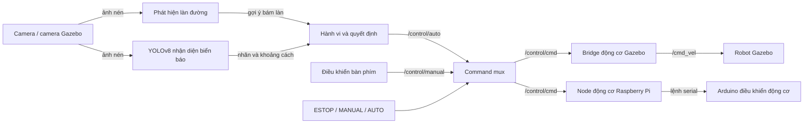
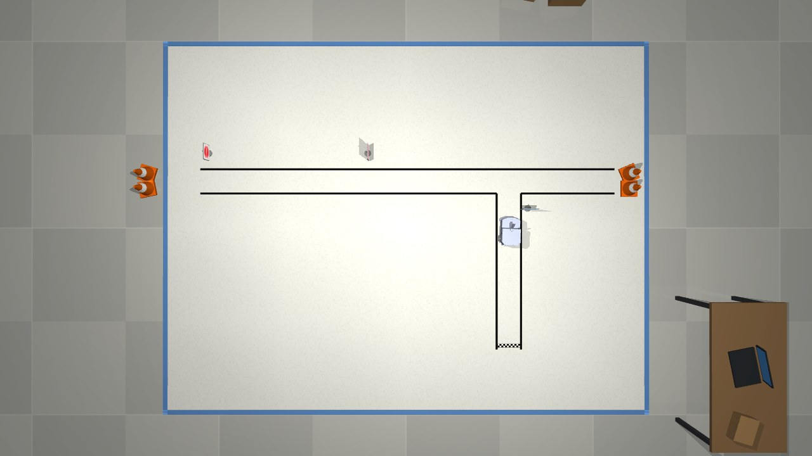
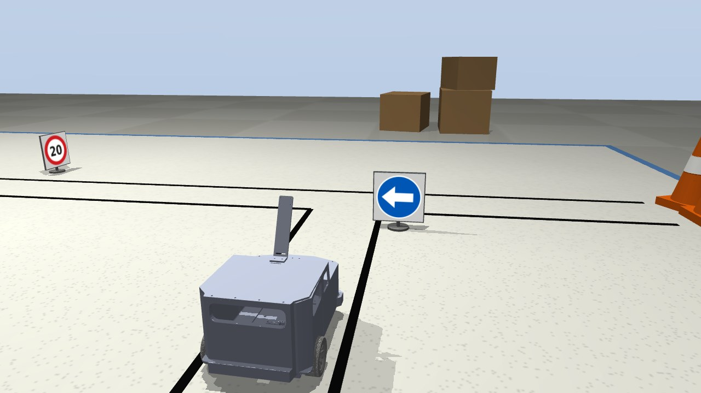
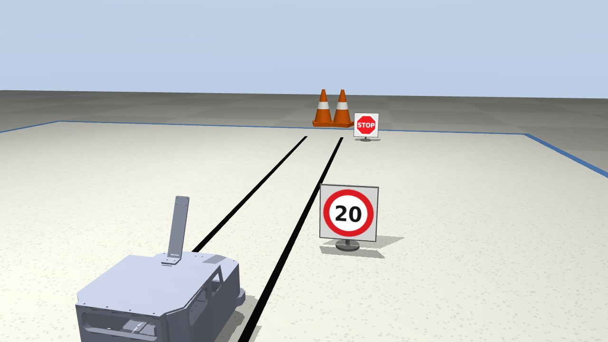
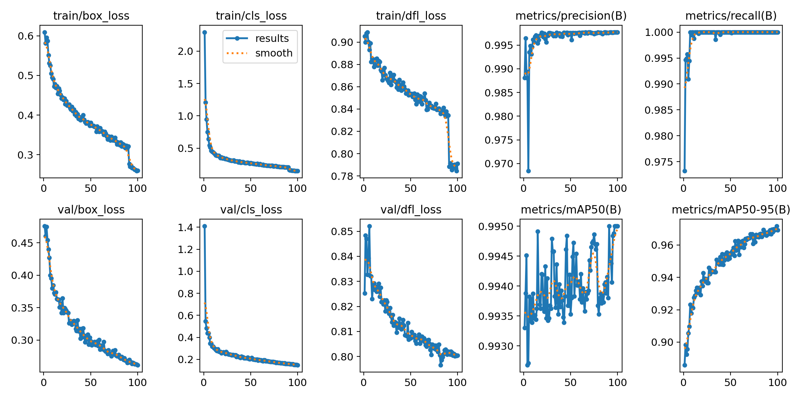
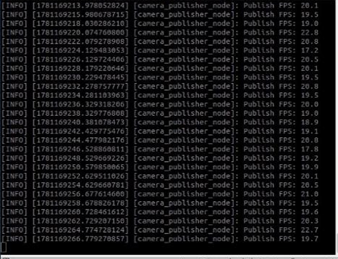

# Xe tự hành sử dụng ROS 2

Nguyên mẫu xe tự hành phân tán kết hợp **ROS 2**, **Gazebo**, **OpenCV**,
**YOLOv8** và **ONNX Runtime**. Hệ thống có khả năng bám làn, nhận diện biển báo,
thực thi hành vi lái và bảo vệ an toàn nhiều tầng trên laptop, Raspberry Pi và
Arduino.

> **Trạng thái dự án:** cả hai workspace build và vượt qua unit test, lint và
> kiểm thử kịch bản end-to-end trong MuJoCo (CI trên GitHub Actions). Số liệu
> bám làn, xử lý biển báo và tốc độ perception trong mô phỏng nằm ở
> [Kết quả đánh giá](#kết-quả-đánh-giá); hệ thống trên xe thật chưa được đo lại
> sau các thay đổi gần nhất.

## Điểm nổi bật

- Dùng chung pipeline từ perception đến điều khiển cho Gazebo và robot thật.
- Phát hiện vạch đường bằng OpenCV và duy trì bám làn khi chỉ thấy một bên vạch.
- Chạy mô hình nhận diện biển báo YOLOv8 tùy chỉnh bằng ONNX Runtime để inference
  ổn định trên CPU trong mô phỏng.
- Xử lý ba biển báo trên sa hình — rẽ trái, tốc độ tối đa 20 km/h và dừng lại —
  bằng node hành vi có trạng thái. Các class khác của detector bị bỏ qua.
- Xác nhận kết quả qua nhiều frame để hạn chế false positive đơn lẻ.
- Hỗ trợ ba chế độ `ESTOP`, `MANUAL` và `AUTO` thông qua command mux riêng.
- Dừng khi dữ liệu perception hoặc điều khiển quá hạn bằng các watchdog 300 ms
  độc lập.
- Giới hạn cả thời điểm bắt đầu và thời gian tối đa của quá trình tìm lại làn.
- Phân chia tính toán giữa laptop và Raspberry Pi qua ROS 2 DDS.

## Kiến trúc hệ thống



Laptop chạy perception, lập kế hoạch hành vi, hiển thị và phân xử lệnh điều
khiển. Raspberry Pi truyền ảnh camera và gửi lệnh động cơ đã được kiểm tra đến
Arduino. Trong mô phỏng, bridge động cơ chuyển đầu ra của mux thành lệnh vận tốc
Gazebo có giới hạn.

## Cấu trúc repository

```text
robot_system/
├── laptop_ws/src/
│   ├── DATN/                 # World Gazebo, URDF, launch và cấu hình mô phỏng
│   ├── mujoco_sim_pkg/       # Mô phỏng cùng sa hình và robot bằng MuJoCo
│   ├── perception_pkg/       # Nhận diện làn đường và biển báo
│   ├── decision_pkg/         # Hành vi, teleop, mux và simulation bridge
│   ├── interfaces_pkg/       # Message Control tùy chỉnh
│   └── bringup_pkg/          # Launch laptop cho robot thật
├── raspberry_ws/src/
│   ├── camera_pkg/           # Xuất bản ảnh camera
│   ├── control_pkg/          # Giao tiếp serial động cơ và watchdog
│   └── interfaces_pkg/       # Message Control dùng chung
├── firmware/code_xe/         # Sketch Arduino: PID lái, PWM động cơ, watchdog 500 ms
├── scripts/fetch_models.py   # Tải trọng số detector và kiểm tra SHA-256
├── tests/                    # Kiểm tra nhất quán giữa các workspace và firmware
├── docs/results/             # Số liệu đánh giá mô phỏng và perception
├── .github/workflows/ci.yml  # Build, test, lint và kịch bản MuJoCo trên CI
├── requirements-laptop.txt
├── requirements-raspberry.txt
└── ENVIRONMENT.md
```

## Chạy nhanh mô phỏng

### 1. Cài đặt môi trường

Cấu hình đã kiểm tra gồm Ubuntu 22.04, ROS 2 Humble, Python 3.10 và Gazebo
Classic 11. Hướng dẫn đầy đủ cho máy tính và Raspberry Pi nằm trong
[ENVIRONMENT.md](ENVIRONMENT.md).

```bash
sudo apt update
sudo apt install -y \
  ros-humble-desktop \
  ros-humble-gazebo-ros-pkgs \
  ros-humble-image-transport-plugins \
  ros-humble-cv-bridge \
  python3-colcon-common-extensions \
  python3-rosdep \
  python3-venv

python3 -m venv --system-site-packages .venv
source .venv/bin/activate
python -m pip install -r requirements-laptop.txt
```

### 2. Cung cấp mô hình nhận diện

Trọng số không nằm trong Git mà ở
[GitHub Release `models-v1`](https://github.com/DangTuyen0604/robot_systems/releases/tag/models-v1).
Script sau tải `yolov8n.onnx` (mô phỏng) và `viet.pt` (xe thật) vào
`laptop_ws/src/perception_pkg/perception_pkg/` và kiểm tra SHA-256:

```bash
python3 scripts/fetch_models.py
```

Checksum và lưu ý tương thích được mô tả tại phần
[mô hình production](ENVIRONMENT.md#production-models).

### 3. Build và khởi chạy

```bash
source /opt/ros/humble/setup.bash
source .venv/bin/activate
cd laptop_ws
rosdep install --from-paths src --ignore-src -r -y
python -m colcon build --symlink-install
source install/setup.bash
ros2 launch DATN sim_full_launch.py
```

Chạy colcon bằng `python -m colcon` từ venv: các node Python khi đó dùng
`.venv/bin/python` và thấy được Torch, Ultralytics, ONNX Runtime và MuJoCo.
Lệnh `colcon` thông thường gắn node với `/usr/bin/python3`, nên các thư viện
trong venv sẽ không được tìm thấy khi chạy node.

Chạy không có giao diện Gazebo và cửa sổ ảnh debug:

```bash
ros2 launch DATN sim_full_launch.py gui:=false show_debug:=false
```

Mô phỏng tương tác mặc định khởi động ở chế độ `AUTO`. Dùng
`initial_mode:=ESTOP` để kiểm tra quá trình kích hoạt thủ công:

```bash
ros2 launch DATN sim_full_launch.py initial_mode:=ESTOP
```

Các tham số như kích thước inference, confidence, vận tốc tối đa, watchdog và
tìm lại làn được tập trung trong
[`simulation.yaml`](laptop_ws/src/DATN/config/simulation.yaml).

### Mô phỏng bằng MuJoCo

`mujoco_sim_pkg` thay Gazebo bằng MuJoCo nhưng giữ nguyên sa hình, robot và
toàn bộ pipeline perception → decision → mux → bridge.

<p align="center">
  
</p>
<p align="center">
  
  
</p>

Sa hình giữ đúng kích thước và vị trí vạch, biển của world Gazebo, nhưng được
dựng giống phòng lab thật: thảm vinyl có vân và viền, băng dính đen, biển báo
có mặt kim loại, cột và đế, cọc tiêu chặn nhánh cụt và cuối đường, bàn làm việc,
đèn trần có bóng đổ. Mọi chi tiết đều được giữ sáng hơn ngưỡng nhận vạch
(grey < 100) để chỉ băng dính được nhận là làn đường. Node `mujoco_sim_node`
nhận `/cmd_vel` giống plugin diff-drive của Gazebo, render camera 320x240 @ 20 FPS
(cùng vị trí gắn và tiêu cự 265 px) rồi publish thẳng `/raw_image/compressed`,
kèm `/odom` là vị trí thật của robot để đánh giá sai số bám làn.

MuJoCo được cài bằng pip (đã có trong `requirements-laptop.txt`), không cần
Gazebo. Sau khi build workspace như trên:

```bash
ros2 launch mujoco_sim_pkg mujoco_full_launch.py
```

Các tùy chọn:

| Tham số | Mặc định | Ý nghĩa |
|---|---|---|
| `gui` | `true` | Mở cửa sổ viewer của MuJoCo |
| `signs` | `true` | Chạy node YOLO nhận diện biển báo (cần file model) |
| `initial_mode` | `AUTO` | Chế độ khởi động của command mux |
| `show_debug` | `false` | Mở `rqt_image_view` |

Ví dụ chạy không giao diện và chưa có model nhận diện:

```bash
ros2 launch mujoco_sim_pkg mujoco_full_launch.py gui:=false signs:=false
```

Camera được render offscreen bằng EGL (`MUJOCO_GL=egl` mặc định). Trên máy không
có EGL, đặt `MUJOCO_GL=osmesa` trước khi launch. Thông số vật lý và camera nằm
trong [`mujoco_sim.yaml`](laptop_ws/src/mujoco_sim_pkg/config/mujoco_sim.yaml)
và [`datn_track.xml`](laptop_ws/src/mujoco_sim_pkg/models/datn_track.xml).

## Thiết kế điều khiển và an toàn

Đường đi của lệnh điều khiển:

```text
/control/lane_suggest
  → /control/auto
  → command_mux
  → /control/cmd
  → motor_node hoặc sim_motor_bridge_node
```

Điều khiển bàn phím chỉ publish vào `/control/manual`. Command mux là node duy
nhất được thiết kế để publish `/control/cmd` và chỉ chọn một chế độ vận hành tại
mỗi thời điểm.

Khi chạy robot thật, mux khởi động trong `ESTOP`. Cần chủ động kích hoạt chế độ
tự hành:

```bash
ros2 topic pub --once /control/mode std_msgs/msg/String "{data: AUTO}"
```

Đưa hệ thống về trạng thái dừng phần mềm:

```bash
ros2 topic pub --once /control/mode std_msgs/msg/String "{data: ESTOP}"
```

Các tầng fail-safe:

| Tầng bảo vệ | Lỗi được phát hiện | Phản ứng |
|---|---|---|
| Decision node | Dữ liệu làn cũ quá 300 ms | Publish lệnh tốc độ bằng 0 |
| Command mux | Lệnh được chọn cũ quá 300 ms | Từ chối lệnh và publish dừng |
| Simulation bridge | `/control/cmd` cũ quá 300 ms | Publish `/cmd_vel` bằng 0 |
| Motor node trên Raspberry Pi | `/control/cmd` quá hạn | Gửi lệnh dừng |
| Firmware Arduino ([`code_xe.ino`](firmware/code_xe/code_xe.ino)) | Không có packet `V:..;E:..` hợp lệ trong 500 ms | Đặt PWM động cơ bằng 0 |

Trong mô phỏng, quá trình tìm lại làn bắt đầu sau 10 frame không thấy làn và bị
dừng sau 30 frame nếu chưa tìm lại được. Các cơ chế dừng bằng phần mềm không thay
thế mạch emergency stop vật lý thường đóng.

## Các ROS interface chính

| Topic | Kiểu dữ liệu | Mục đích |
|---|---|---|
| `/raw_image/compressed` | `sensor_msgs/CompressedImage` | Ảnh đầu vào từ camera |
| `/perception/detected_label` | `std_msgs/String` | Nhãn biển báo đã xác nhận |
| `/perception/sign_distance` | `std_msgs/Float32` | Khoảng cách ước lượng đến biển |
| `/control/lane_suggest` | `interfaces_pkg/Control` | Gợi ý điều khiển bám làn |
| `/control/auto` | `interfaces_pkg/Control` | Đầu ra quyết định tự hành |
| `/control/manual` | `interfaces_pkg/Control` | Đầu ra điều khiển thủ công |
| `/control/cmd` | `interfaces_pkg/Control` | Lệnh động cơ đã qua mux |
| `/control/mode` | `std_msgs/String` | Yêu cầu chuyển chế độ |
| `/control/mux_status` | `std_msgs/String` | Chế độ hiện tại hoặc trạng thái timeout |
| `/diagnostics/decision` | `std_msgs/String` | Chẩn đoán trạng thái hành vi |
| `/diagnostics/sim_motor` | `std_msgs/String` | Chẩn đoán simulation bridge |
| `/arduino/pid` | `std_msgs/String` | Chỉnh PID `KS:<p>;KSI:<i>;KSD:<d>` (lái) hoặc `P:<p>;I:<i>;D:<d>` (tốc độ) khi xe đứng yên |
| `/arduino/telemetry` | `std_msgs/String` | Mọi dòng Arduino gửi về, gồm debug 10 Hz có số xung encoder |

### Firmware Arduino

[`firmware/code_xe/code_xe.ino`](firmware/code_xe/code_xe.ino) nhận lệnh
`V:<pwm 0..255>;E:<sai số pixel>` từ `motor_node`, tính PID lái và xuất PWM
cho hai động cơ. Mở thư mục `firmware/code_xe` bằng Arduino IDE để nạp.

- `motor_node` chỉ chuyển xuống Arduino gói chỉnh PID đúng định dạng
  `KS:..;KSI:..;KSD:..` hoặc `P:..;I:..;D:..` khi xe đang được lệnh đứng yên;
  gói chứa lệnh chạy bị chặn để không đi vòng qua command mux. Firmware bỏ dòng
  dài hơn 32 ký tự.
- PID tốc độ dùng encoder là tùy chọn (`USE_SPEED_PID`, mặc định 0 = PWM vòng
  hở như trước). Chỉ bật sau khi encoder đếm đúng và đã đo lại
  `MAX_PULSES_PER_INTERVAL` trên xe.
- Encoder trái/phải nối chân 12 và 4. Trên Uno/Nano (ATmega328P) firmware đếm
  bằng ngắt đổi trạng thái chân (pin-change), vì `attachInterrupt()` chỉ hoạt
  động ở chân 2 và 3. Board khác sẽ in cảnh báo nếu chân không có ngắt.
- `MIN_PWM` (65) là ngưỡng động cơ bắt đầu quay: mọi lệnh chạy được nâng lên ít
  nhất mức này. Dùng số xung `EL`/`ER` trên `/arduino/telemetry` để đo tốc độ
  bánh theo PWM trước khi chỉnh ngưỡng hoặc tốc độ chậm.

## Kiểm thử

Mỗi package có unit test và lint của ament (flake8, pep257, xmllint, lint_cmake):

```bash
source /opt/ros/humble/setup.bash && source .venv/bin/activate
cd laptop_ws && source install/setup.bash
python -m colcon test && python -m colcon test-result --verbose
cd ../raspberry_ws && python -m colcon build && python -m colcon test   # tương tự
cd .. && python -m pytest tests   # interfaces_pkg hai bản giống nhau, giao thức khớp firmware
```

Các nhóm test chính:

- **An toàn điều khiển:** `ESTOP` không chuyển lệnh, lệnh cũ hoặc thiếu bị từ
  chối, vận tốc mô phỏng bị giới hạn, bridge chỉ nhận đầu ra của mux.
- **Hành vi biển báo:** chỉ ba biển đang dùng được thực hiện, biển 20 km/h không
  chạy khi mất làn, `cam_re_phai` không bao giờ kích hoạt rẽ phải.
- **Serial:** `/arduino/pid` chỉ nhận gói PID đúng định dạng khi xe đứng yên;
  gói chạy luôn nằm trong giới hạn mà firmware chấp nhận.
- **Mô phỏng:** robot MuJoCo đứng cân bằng, đi thẳng, quay đúng chiều; camera có
  cùng tiêu cự với Gazebo.
- **Kịch bản end-to-end** (`mujoco_sim_pkg/test/test_scenario.py`): toàn bộ hệ
  thống chạy trên sa hình MuJoCo và phải giữ làn, rẽ đúng nhánh trái, đi chậm ở
  biển 20, dừng ở biển STOP và tới cuối đường. Chạy với `MUJOCO_SCENARIO=1`,
  khoảng 1 phút mỗi kịch bản.

CI ([`.github/workflows/ci.yml`](.github/workflows/ci.yml)) chạy toàn bộ các bước
trên trong container `ros:humble` cho mỗi push và pull request.

## Kiểm tra chèn lỗi bắt buộc

Trước khi chạy robot thật, cần xác nhận toàn bộ trường hợp sau:

- Ngắt camera: `/control/auto` và `/control/cmd` phải về tốc độ 0.
- Dừng decision node hoặc ngắt Wi-Fi: watchdog của mux/motor phải dừng xe.
- Ngắt serial: watchdog Arduino phải đưa PWM về 0.
- Kết nối lại serial: xe vẫn đứng yên cho đến khi nhận được lệnh mới.
- Giữ biển STOP trước camera: biển chỉ kích hoạt một lần và chỉ được kích hoạt
  lại sau khi biến mất.

## Video demo

- [Demo xe chạy mô phỏng (Gazebo)](https://drive.google.com/file/d/1dBT1ogTiThg2gMlb9Enwx0kLMsxEHvZB/view?usp=drive_link)
- [Demo xe chạy phần cứng](https://drive.google.com/file/d/1XgVCvXy4kMGLnkwK37TSTM-VURQFna5z/view?usp=sharing)
- [Trang tổng hợp video demo](docs/demo/README.md)

## Kết quả đánh giá

### Kịch bản mô phỏng MuJoCo

5 lượt chạy toàn bộ hệ thống (YOLOv8 ONNX 320 px, real-time) trên sa hình chữ T,
mỗi lượt tới khi xe dừng ở cuối đường. Sai số đo từ vị trí thật (`/odom`) của
`base_link` tới tâm làn. Chi tiết từng lượt:
[`docs/results/mujoco_evaluation.md`](docs/results/mujoco_evaluation.md).

| Chỉ số | Kết quả |
|---|---|
| Hoàn thành tuyến (giữ làn, rẽ trái đúng nhánh, tới cuối đường) | 5/5 |
| Thời gian hoàn thành | 52,5 ± 2,4 s |
| Sai số tâm làn đoạn thẳng: trung bình / lớn nhất | 1,0 / 11,0 mm |
| Sai số tâm làn nhánh trái: trung bình / lớn nhất | 5,4 / 34,8 mm |
| Đi chậm ở biển 20 km/h | 5,0 s (cấu hình 5 s) |
| Dừng ở biển STOP | 4,9 s (cấu hình 5 s) |

Sai số lớn nhất ở nhánh trái xuất hiện ngay sau khúc rẽ, khi xe bắt lại làn.
Tái lập bằng `ros2 run mujoco_sim_pkg evaluate --runs 5`.

### Tốc độ xử lý perception

Đo trên Intel Core i7-9850H, chỉ CPU, 200 ảnh camera 320x240, từng ảnh một như
trong node ROS ([chi tiết](docs/results/perception_benchmark.md); tái lập bằng
`ros2 run perception_pkg benchmark`).

| Bước | Trung bình | p95 | Tối đa |
|---|---|---|---|
| Bám làn (OpenCV) + điều khiển | 4,8 ms | 5,1 ms | ~210 FPS |
| Biển báo `yolov8n.onnx` 320 px (mô phỏng) | 23,5 ms | 30,0 ms | ~42 FPS |
| Biển báo `viet.pt` 640 px (xe thật) | 50,2 ms | 51,9 ms | ~20 FPS |

Node biển báo xử lý 1/2 số ảnh của camera 20 FPS, nên mỗi lần suy luận có 100 ms;
cả hai model đều nằm trong giới hạn này trên CPU.

### Độ chính xác nhận diện (mAP)

Kết quả đánh giá detector trên tập kiểm thử:

<p align="center">
  
</p>

### FPS trên phần cứng

Kết quả đo FPS trên phần cứng triển khai:

<p align="center">
  
</p>

## Giới hạn hiện tại và hướng phát triển

- Hệ thống chỉ nhận diện ba biển báo (rẽ trái, tốc độ tối đa 20 km/h, dừng
  lại); không có model đèn giao thông.
- Nhận diện làn dùng threshold và contour của OpenCV. Mọi ngưỡng là tham số ROS
  của `lane_node_instance` (xem `perception_pkg/lane_detector.py`) và cần chỉnh
  lại theo ánh sáng của sa hình thật.
- Logic ngã ba dành cho sa hình chữ T hiện tại: decision node coi việc mất làn
  sau khi thấy biển rẽ là đã tới giao lộ, và chế độ tìm làn của mô phỏng luôn
  rẽ trái. Một sa hình khác cần cơ chế nhận diện giao lộ riêng.
- Node làn và node biển bỏ ảnh cũ hơn 0,5 s theo thời điểm chụp
  (`max_image_age`), nên đồng hồ Raspberry Pi và laptop phải được đồng bộ.
- Số liệu bám làn và hoàn thành kịch bản hiện chỉ có trong mô phỏng MuJoCo; xe
  thật cần được đo bằng cùng chỉ số.
- Dự án sử dụng Gazebo Classic 11 để phù hợp với ROS 2 Humble. Gazebo Classic
  đã ngừng hỗ trợ từ 01/2025; mô phỏng MuJoCo là phương án thay thế.

Các số liệu nên bổ sung tiếp: tốc độ bánh theo PWM (`ros2 run control_pkg
encoder_rate` trên xe), sai số bám làn trên sa hình thật và thời gian từ khi xảy
ra lỗi đến khi xe dừng.

## Công nghệ sử dụng

ROS 2 Humble · Python · Gazebo Classic · MuJoCo · OpenCV · YOLOv8 · ONNX Runtime ·
PyTorch · NumPy · Raspberry Pi · Arduino · Serial · DDS
